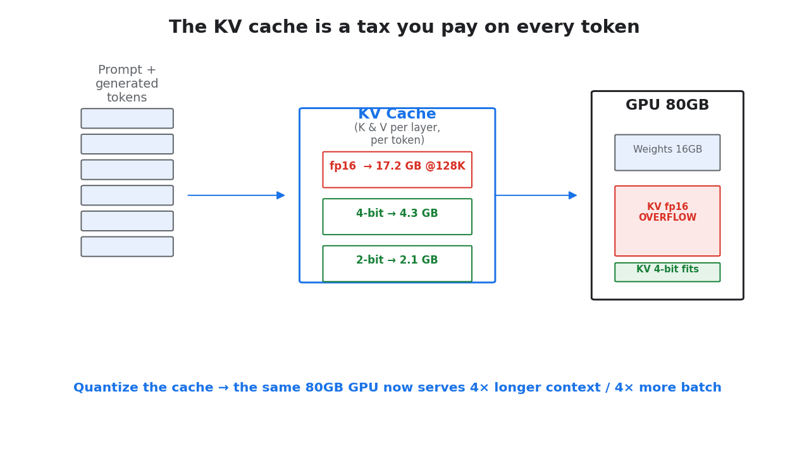
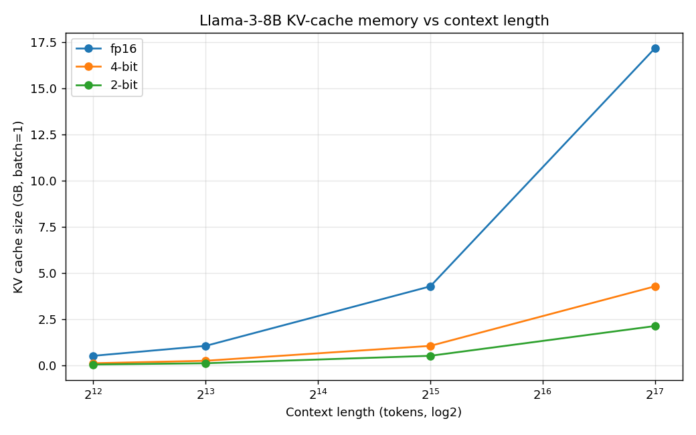

# KV-Cache Quantization: How I Shrunk LLM Memory 4–8× Without Losing Quality

You finally get the request you've been waiting for: a 128K-token context window. Your GPU has 80 GB.
The model weights take 16 GB. The rest should be plenty — until you do the math on the **KV cache** and
realize it alone wants 17 GB, and that's just *one* request at fp16. Add a batch and the GPU quietly
tips over into out-of-memory.

That cache is the part of LLM inference nobody talks about in the splashy benchmark posts. It's the rent
you pay on every token you've ever processed, and as context windows and batch sizes grow, it — not the
weights — decides whether your workload fits. The good news: you can store that cache in 4-bit, even
2-bit, and barely move the quality needle. The catch: round it the wrong way and attention silently
falls apart.

This is the post I wish I'd had before I started quantizing caches. Here's what actually works, what
breaks, and the memory math I verified myself.

## Goal

By the end you should be able to answer:

- Why the KV cache — not the weights — is the memory wall on long context.
- Why a naive `round()` on the cache is a silent quality killer.
- Which quantization scheme to reach for: **KIVI**, **KVQuant**, or **GEAR**.
- How to compute the cache size for *your* model in 30 lines of Python.

## Component 1 — The cache is a tax that scales with tokens

Every transformer layer keeps the Key and Value vectors of every token it has seen, so attention doesn't
have to recompute them. That storage is:

```
KV_bytes = 2 · n_layers · n_kv_heads · head_dim · bytes_per_elem · seq_len · batch
```

For **Llama-3-8B** (32 layers, 8 KV heads, head_dim 128) that's **128 KiB per token at fp16**, and it
grows linearly with both sequence length and batch. The picture below is the whole problem in one frame.



And here are the actual numbers:

| Context (tokens) | fp16   | 8-bit | 4-bit | 2-bit |
|------------------|--------|-------|-------|-------|
| 4,096            | 0.54 GB| 0.27 GB| 0.13 GB| 0.07 GB|
| 8,192            | 1.07 GB| 0.54 GB| 0.27 GB| 0.13 GB|
| 32,768           | 4.29 GB| 2.15 GB| 1.07 GB| 0.54 GB|
| 131,072          | 17.18 GB| 8.59 GB| 4.29 GB| 2.15 GB|

Now batch 64 requests at 32K: the fp16 cache alone is **~275 GB** — past any single GPU. Even 4-bit
leaves ~69 GB. This is why long-context serving is **memory-bound**: the GPU's compute cores sit idle
while the KV cache is shuffled from main memory into SRAM for every generated token (KIVI, ICML 2024).

> [!WARNING]
> Smaller cache ≠ automatic speedup. The win is *throughput via bigger batches*, and only if your serving
> stack (paged memory, fused dequant-matmul, correct calibration) supports KV quantization end to end.
> Quantize the tensor but not the memory manager and you get neither.

## Component 2 — The trap: keys and values break differently

The obvious move is uniform, per-token quantization. That's also the mistake. The reason is in the
*distribution*, not the arithmetic:

- **Keys have a few fixed outlier channels.** Same channels, every token, disproportionately large
  (the activation-outlier pattern from LLM.int8() and AWQ). Quantizing keys *per-token* smears those
  spikes into every normal channel.
- **Values have no such pattern**, but they're mixed by attention into the output, so errors couple
  across tokens. Quantizing values *per-channel* lets one token's error leak into another's.

KIVI measured the fallout directly: per-token key quantization produces nearly **5× larger attention
score error** than per-channel key quantization, and per-channel value quantization is **~15× worse**
than per-token. The fix is asymmetric and non-obvious — **quantize keys per-channel, values per-token**
— and that single insight is what makes 2-bit caches viable.


A minimal sketch of the right scheme:

```python
# Asymmetric KV quantization (KIVI-style)
def quantize_key_per_channel(K, bits=2):
    # K: [n_kv_heads, seq, head_dim] -> scale per channel
    scale = K.abs().amax(-1, keepdim=True) / (2**bits - 1)
    return round(K / scale).clamp(...), scale          # dequant: Q * scale

def quantize_value_per_token(V, bits=2):
    # V: [n_kv_heads, seq, head_dim] -> scale per token
    scale = V.abs().amax(-2, keepdim=True) / (2**bits - 1)
    return round(V / scale).clamp(...), scale
```

## Component 3 — Three schemes that actually ship

Three papers define the frontier. They agree on the outlier structure and diverge on how hard they push
the bit-width.

| Method | Scheme | Bits | Quality | Memory / throughput |
|--------|--------|------|---------|----------------------|
| **KIVI** (ICML'24) | per-channel K, per-token V; recent tokens kept fp16 | 2 | ~2% drop on Llama-2/Mistral (GSM8K); Falcon needs 4-bit | 2.6× peak mem, 4× larger batch, **2.35–3.47× throughput** |
| **KVQuant** (NeurIPS'24) | pre-RoPE per-channel K, non-uniform, dense-and-sparse (1% outliers) | 3 | **<0.1 perplexity drop** (WikiText-2, C4) | 4.8× compression; LLaMA-7B at **1M ctx on 1× A100**, 10M on 8× GPU; ~1.7× matvec speedup |
| **GEAR** (ICML'24) | quantization + low-rank error + sparse outliers | 2 | near-lossless; up to **24.4% over SOTA** at 2-bit | 2.39× peak mem, **2.1–5.07× throughput** |

- **KIVI is the pragmatic default.** Tuning-free, plug-and-play, ships as a HuggingFace wrapper. The
  full-precision window for the most recent tokens is what rescues hard reasoning — without it, fake
  2-bit on GSM8K craters.
- **KVQuant is the "go long" play.** By quantizing *before* RoPE (which otherwise mixes outlier
  channels) and using sensitivity-weighted non-uniform codebooks plus a 1% sparse outlier store, it
  reaches 3-bit with sub-0.1 perplexity loss and turns context length into a tunable dial.
- **GEAR is the "go low" play.** Instead of fighting residuals it models them: a low-rank matrix
  recovers the coherent part of the quantization error, a sparse matrix catches the rest. It layers on
  top of any base quantizer and is the only one of the three that stays near-lossless at 2-bit on
  complex generation.

> [!WARNING]
> These numbers are method-specific. KIVI reports that **Falcon-7B (multi-query attention, a single KV
> head) needs 4-bit, not 2-bit** — MQA is already so compressed there's no redundancy left to trade. If
> your model uses MQA, don't assume 2-bit works.

## Where it still breaks

1. **Small model + long context = danger zone.** Perplexity degradation grows as you shrink the model
   and lengthen the prompt; the headroom that hides quantization error in a 70B model doesn't exist in
   a 7B one.
2. **Reasoning tasks are unforgiving.** GSM8K-style math is where fake quantization fails hardest; the
   recent-token window (KIVI) or low-rank residual (GEAR) is not optional.
3. **Throughput only follows if the kernel exists.** KVQuant and GEAR ship custom CUDA kernels; without
   fused dequant-matmul the overhead eats the memory win. Production stacks (vLLM, TensorRT-LLM) now
   default to **fp8 KV cache** — 2× smaller, near-lossless, hardware-accelerated on Hopper/Ada. 4-bit and
   below still need the research kernels.
4. **Calibration matters at the low end.** KVQuant calibrates key scales offline; skip it and 3-bit
   quality drops sharply.

## I verified the memory math myself

The tables above aren't benchmark results — they're deterministic accounting that tells you whether the
request fits at all. Here's the whole computation, and it runs in 30 lines:

```python
def kv_bytes(seq_len, batch, bits):
    # 2 (K and V) * layers * kv_heads * head_dim * (bits/8) * seq * batch
    return 2 * 32 * 8 * 128 * (bits / 8) * seq_len * batch

print(kv_bytes(131072, 1, 16) / 1e9)   # 17.18 GB  (fp16, 1 req, 128K)
print(kv_bytes(131072, 1, 4)  / 1e9)   # 4.29 GB   (4-bit)
```



Run it and you get the figures in this post. That's the question KV-cache quantization exists to answer:
*does this request fit?*

## Takeaway

KV-cache quantization is the rare optimization that's both mathematically simple and empirically subtle.
The win is real and large — **4–8× memory, 2–5× throughput** — but it's earned by respecting the cache's
outlier structure, not by rounding harder. For most teams the right move today is **fp8 in the serving
stack**; for the long-context frontier, **KVQuant** and **GEAR** show 2–3-bit caches are deployable, not
research curiosities.

Next up: I'll break down **speculative decoding** the same way — where the famous 2–3× claim actually
holds, and where it quietly loses.

## References

- Liu et al., **KIVI: A Tuning-Free Asymmetric 2bit Quantization for KV Cache** (ICML 2024).
  [arXiv:2402.02750](https://arxiv.org/abs/2402.02750) · [github.com/jy-yuan/KIVI](https://github.com/jy-yuan/KIVI)
- Hooper et al., **KVQuant: Towards 10 Million Context Length LLM Inference with KV Cache Quantization**
  (NeurIPS 2024). [arXiv:2401.18079](https://arxiv.org/abs/2401.18079) · [github.com/SqueezeAILab/KVQuant](https://github.com/SqueezeAILab/KVQuant)
- Kang et al., **GEAR: An Efficient Error Reduction Framework for KV Cache Compression in LLM Inference**
  (ICML 2024). [arXiv:2403.05527](https://arxiv.org/abs/2403.05527) · [github.com/opengear-project/GEAR](https://github.com/opengear-project/GEAR)
- Kwon et al., **vLLM / PagedAttention** (SOSP 2023) — the system layer KV quantization slots into.
  [arXiv:2309.06180](https://arxiv.org/abs/2309.06180)
