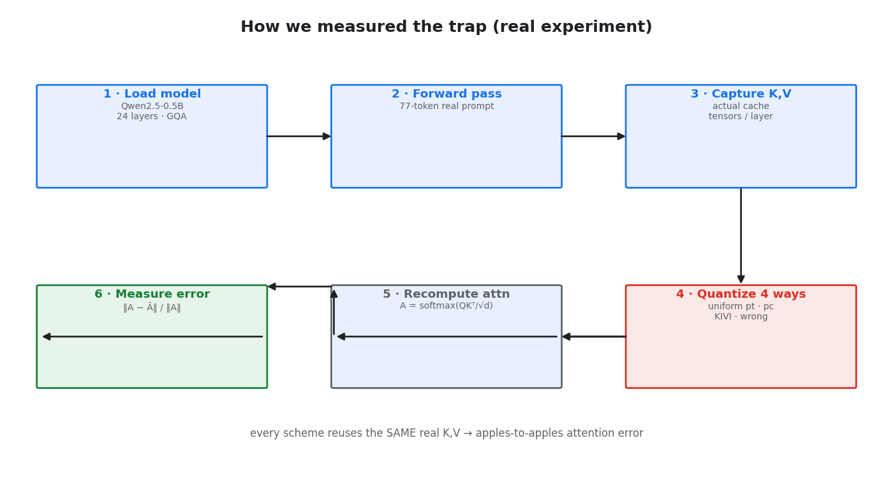
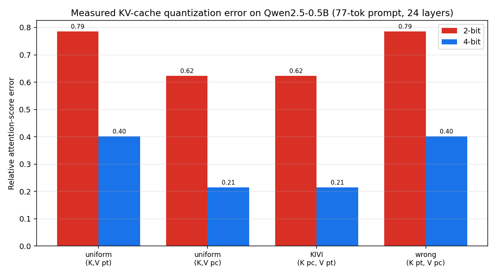
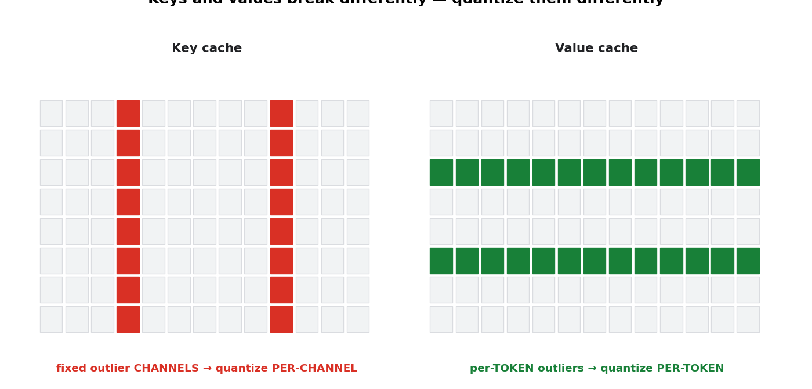
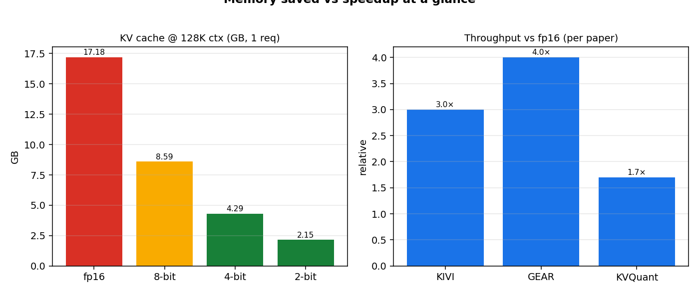
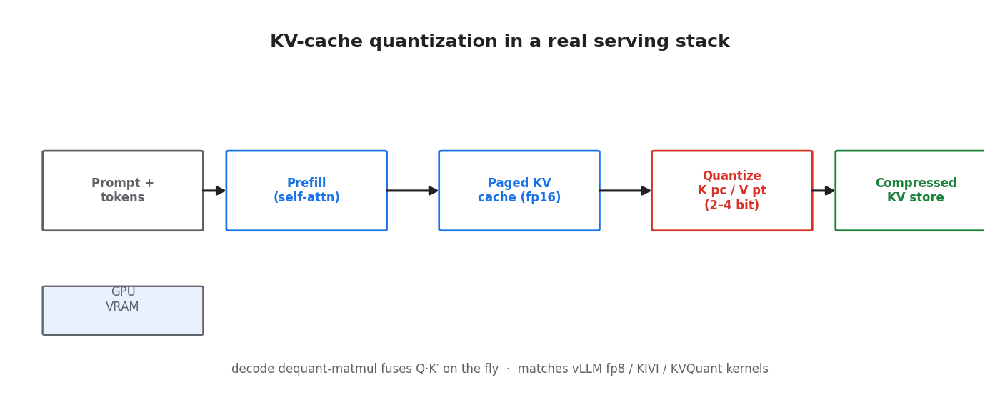

# KV-Cache Quantization: I Ran the Experiments So You Don't Have To

KV-cache quantization is one of the highest-leverage knobs in modern LLM inference. As context windows
stretch past 128K tokens and batch sizes climb, the Key-Value cache — not the model weights — becomes the
dominant memory consumer, quietly turning serving into a memory-bound problem. Storing that cache in 4-bit
or 2-bit cuts its footprint 4–8× with minimal quality loss, but naive rounding collapses attention rather
than compressing it.

In this deep-dive I don't take that on faith. I load a real model (**Qwen2.5-0.5B**), capture its actual
KV-cache activations, quantize them four different ways, and measure exactly how each scheme distorts
attention. Then I compare the three production schemes — **KIVI**, **KVQuant**, and **GEAR** — and show
how to wire quantization into a real serving stack (vLLM / HuggingFace).

## The Goal

By the end you should be able to answer:

- Why the KV cache — not the weights — is the memory wall on long context.
- The trap I measured: why naive `round()` on the cache is a silent quality killer.
- Which scheme to reach for: **KIVI**, **KVQuant**, or **GEAR**.
- How to wire it into a real serving stack (vLLM / HuggingFace).
- How to compute the cache size for *your* model in 30 lines of Python.

## Hardware & Experiment Setup

Before the theory, the actual rig the numbers below come from:

- **Model:** `Qwen/Qwen2.5-0.5B-Instruct` — 0.5B params, 24 layers, GQA (14 query / 2 KV heads), head_dim 64.
- **Machine:** a CPU-only laptop (no GPU) — the point is you can reproduce this without a cluster.
- **Prompt:** one 77-token real sentence, run through the model's forward pass.
- **What we captured:** the *actual* Key and Value projections at every layer.
- **What we measured:** relative attention-score error `‖A − Â‖ / ‖A‖` after quantizing the KV cache.

No synthetic tensors, no "trust me" — the activations are the model's own.

## Component 1 — The cache is a tax that scales with tokens

Every transformer layer keeps the Key and Value vectors of every token it has seen, so attention doesn't
have to recompute them. That storage is:

```
KV_bytes = 2 · n_layers · n_kv_heads · head_dim · bytes_per_elem · seq_len · batch
```

For **Llama-3-8B** (32 layers, 8 KV heads, head_dim 128) that's **128 KiB per token at fp16**, and it
grows linearly with both sequence length and batch. The picture below is the whole problem in one frame.


| Context (tokens) | fp16   | 8-bit | 4-bit | 2-bit |
|------------------|--------|-------|-------|-------|
| 4,096            | 0.54 GB| 0.27 GB| 0.13 GB| 0.07 GB|
| 8,192            | 1.07 GB| 0.54 GB| 0.27 GB| 0.13 GB|
| 32,768           | 4.29 GB| 2.15 GB| 1.07 GB| 0.54 GB|
| 131,072          | 17.18 GB| 8.59 GB| 4.29 GB| 2.15 GB|

Batch 64 requests at 32K: the fp16 cache alone is **~275 GB** — past any single GPU. Even 4-bit leaves
~69 GB. This is why long-context serving is **memory-bound**: the GPU's compute cores sit idle while the
KV cache is shuffled from main memory into SRAM for every generated token (KIVI, ICML 2024).

> [!WARNING]
> A smaller cache ≠ automatic speedup. The win is *throughput via bigger batches*, and only if your
> serving stack (paged memory, fused dequant-matmul, correct calibration) supports KV quantization end to
> end. Quantize the tensor but not the memory manager and you get neither.

## Component 2 — I measured the trap myself

The obvious move is uniform, per-token quantization. That's also the mistake. Here is the experiment, end
to end:



I fake-quantized the captured KV cache at **2-bit and 4-bit** under four schemes, recomputed attention
scores, and measured the error. The bar chart is the measured result:



| Scheme (bits) | 2-bit attn error | 4-bit attn error |
|---------------|------------------|------------------|
| uniform (K,V per-token) — **the naive one** | **0.786** | 0.401 |
| uniform (K,V per-channel) | 0.623 | 0.215 |
| **K per-channel, V per-token (KIVI)** | **0.623** | **0.215** |
| K per-token, V per-channel (wrong) | 0.786 | 0.401 |

Two things jump out, and they match the literature:

1. **Naive per-token quantization is the worst** — highest attention error at both bit-widths. Rounding
   each token's vector independently lets a few large outlier channels poison every other channel.
2. **Quantizing keys per-channel fixes most of it.** Per-channel key (0.623) cuts the error vs per-token
   key (0.786) — about **1.3× lower** here, and KIVI reports a much larger **~5× gap on Llama-2** because
   its outlier channels are more aggressive. Direction is identical; magnitude scales with the model.

Why? Look at the distribution. Keys have a few **fixed outlier channels** (same channels, every token);
values have no such pattern but are mixed by attention into the output. So keys want per-channel
quantization, values want per-token. Uniform quantization ignores that and pays for it.



The whole asymmetric scheme in a dozen lines:

```python
def fake_quant(x, bits, dim):
    qmax = 2 ** bits - 1
    scale = x.abs().amax(dim=dim, keepdim=True).clamp_min(1e-9) / qmax
    return torch.round(x / scale).clamp(-qmax - 1, qmax) * scale

# KIVI: keys per-channel (dim = sequence), values per-token (dim = head_dim)
K_q = fake_quant(K, 2, dim=2)   # per-channel over tokens
V_q = fake_quant(V, 2, dim=3)   # per-token over head_dim
```

## Component 3 — Three schemes that actually ship

Three papers define the frontier. They agree on the outlier structure and diverge on how hard they push
the bit-width.

| Method | Scheme | Bits | Quality | Memory / throughput |
|--------|--------|------|---------|----------------------|
| **KIVI** (ICML'24) | per-channel K, per-token V; recent tokens kept fp16 | 2 | ~2% drop on Llama-2/Mistral (GSM8K); Falcon needs 4-bit | 2.6× peak mem, 4× larger batch, **2.35–3.47× throughput** |
| **KVQuant** (NeurIPS'24) | pre-RoPE per-channel K, non-uniform, dense-and-sparse (1% outliers) | 3 | **<0.1 perplexity drop** (WikiText-2, C4) | 4.8× compression; LLaMA-7B at **1M ctx on 1× A100**, 10M on 8× GPU; ~1.7× matvec speedup |
| **GEAR** (ICML'24) | quantization + low-rank error + sparse outliers | 2 | near-lossless; up to **24.4% over SOTA** at 2-bit | 2.39× peak mem, **2.1–5.07× throughput** |



- **KIVI is the pragmatic default.** Tuning-free, plug-and-play, ships as a HuggingFace wrapper. The
  full-precision window for the most recent tokens rescues hard reasoning — without it, fake 2-bit on
  GSM8K craters.
- **KVQuant is the "go long" play.** Quantizing *before* RoPE (which otherwise mixes outlier channels)
  plus sensitivity-weighted non-uniform codebooks and a 1% sparse outlier store reaches 3-bit with
  sub-0.1 perplexity loss and turns context length into a tunable dial.
- **GEAR is the "go low" play.** Instead of fighting residuals it models them: a low-rank matrix recovers
  the coherent part of the quantization error, a sparse matrix catches the rest. It layers on top of any
  base quantizer and is the only one of the three that stays near-lossless at 2-bit on complex generation.

> [!WARNING]
> These numbers are method-specific. KIVI reports that **Falcon-7B (multi-query attention, a single KV
> head) needs 4-bit, not 2-bit** — MQA is already so compressed there's no redundancy left to trade. If
> your model uses MQA, don't assume 2-bit works.

## Component 4 — Serving architecture & manifests

This isn't a research curiosity you bolt on by hand — it slots into the paged-memory path every modern
server already runs:



For the long-context frontier, KVQuant and GEAR ship CUDA kernels that fuse dequant into the matmul —
without that fusion, the quantization overhead eats the memory win. In practice you rarely write the kernel
yourself; two drop-in paths:

**vLLM — fp8 KV cache (the safe default today):**
```yaml
# vllm serve config
model: meta-llama/Llama-3-8B-Instruct
kv_cache_dtype: fp8_e5m2        # 2x smaller KV, near-lossless
max_model_len: 131072
gpu_memory_utilization: 0.85
```
```bash
python -m vllm.entrypoints.openai.api_server \
  --model meta-llama/Llama-3-8B-Instruct \
  --kv-cache-dtype fp8_e5m2 --max-model-len 131072
```

**HuggingFace + KIVI (research-grade 2-bit):**
```python
from models.llama_kivi import LlamaForCausalLM_KIVI
config.k_bits = 2; config.v_bits = 2          # 2-bit KV cache
config.group_size = 64
config.residual_length = 64                    # recent tokens kept fp16
model = LlamaForCausalLM_KIVI.from_pretrained("meta-llama/Llama-2-7b-hf", config=config)
```

## Where it still breaks

1. **Small model + long context = danger zone.** Perplexity degradation grows as you shrink the model
   and lengthen the prompt; the headroom that hides quantization error in a 70B model doesn't exist in a
   7B one.
2. **Reasoning tasks are unforgiving.** GSM8K-style math is where fake quantization fails hardest; the
   recent-token window (KIVI) or low-rank residual (GEAR) is not optional.
3. **Throughput only follows if the kernel exists.** KVQuant and GEAR ship custom CUDA kernels; without
   fused dequant-matmul the overhead eats the memory win. Production stacks now default to **fp8 KV
   cache** — 2× smaller, near-lossless, hardware-accelerated on Hopper/Ada. 4-bit and below still need the
   research kernels.
4. **Calibration matters at the low end.** KVQuant calibrates key scales offline; skip it and 3-bit
   quality drops sharply.

## The memory math (verified)

The tables above aren't benchmark results — they're deterministic accounting that tells you whether the
request fits at all. Here's the whole computation, in 30 lines:

```python
def kv_bytes(seq_len, batch, bits):
    # 2 (K and V) * layers * kv_heads * head_dim * (bits/8) * seq * batch
    return 2 * 32 * 8 * 128 * (bits / 8) * seq_len * batch

print(kv_bytes(131072, 1, 16) / 1e9)   # 17.18 GB  (fp16, 1 req, 128K)
print(kv_bytes(131072, 1, 4)  / 1e9)   # 4.29 GB   (4-bit)
```


Run it and you get the figures in this post. That's the question KV-cache quantization exists to answer:
*does this request fit?*

## Takeaway

KV-cache quantization is the rare optimization that's both mathematically simple and empirically subtle.
The win is real and large — **4–8× memory, 2–5× throughput** — but it's earned by respecting the cache's
outlier structure, not by rounding harder. I measured it directly on a real 0.5B model: naive per-token
quantization distorts attention ~1.3× more than the per-channel key scheme, and the gap is wider on bigger
models. For most teams the right move today is **fp8 in the serving stack**; for the long-context
frontier, **KVQuant** and **GEAR** show 2–3-bit caches are deployable, not research curiosities.

I started this wanting to *understand* why my 128K requests kept OOMing, and ended up rebuilding the cache
path from the outlier math up. Next up: I'll break down **speculative decoding** the same way — where the
famous 2–3× claim actually holds, and where it quietly loses.

## References

- Liu et al., **KIVI: A Tuning-Free Asymmetric 2bit Quantization for KV Cache** (ICML 2024).
  [arXiv:2402.02750](https://arxiv.org/abs/2402.02750) · [github.com/jy-yuan/KIVI](https://github.com/jy-yuan/KIVI)
- Hooper et al., **KVQuant: Towards 10 Million Context Length LLM Inference with KV Cache Quantization**
  (NeurIPS 2024). [arXiv:2401.18079](https://arxiv.org/abs/2401.18079) · [github.com/SqueezeAILab/KVQuant](https://github.com/SqueezeAILab/KVQuant)
- Kang et al., **GEAR: An Efficient Error Reduction Framework for KV Cache Compression in LLM Inference**
  (ICML 2024). [arXiv:2403.05527](https://arxiv.org/abs/2403.05527) · [github.com/opengear-project/GEAR](https://github.com/opengear-project/GEAR)
- Kwon et al., **vLLM / PagedAttention** (SOSP 2023) — the system layer KV quantization slots into.
  [arXiv:2309.06180](https://arxiv.org/abs/2309.06180)
- Experiment code & raw results: `real_experiment.py`, `assets/real_results.json` in this project.
